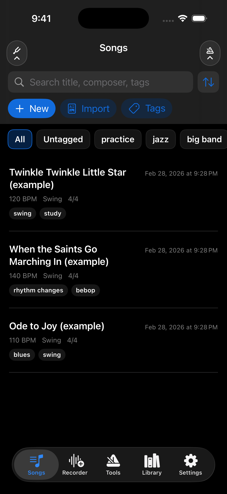
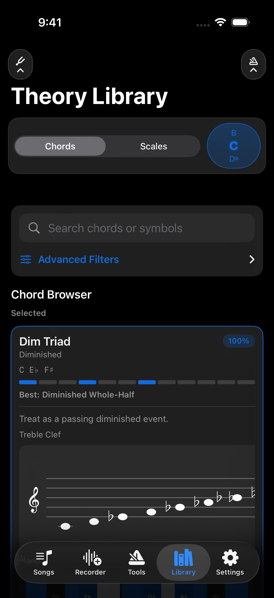
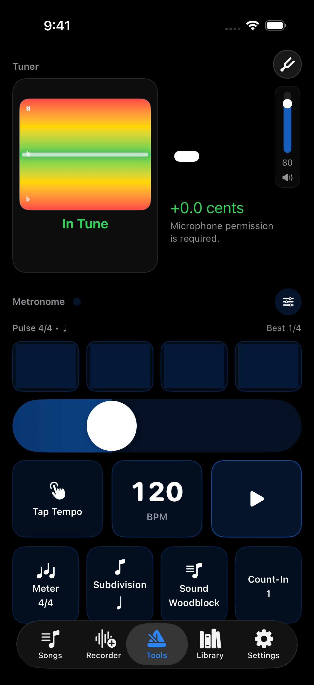
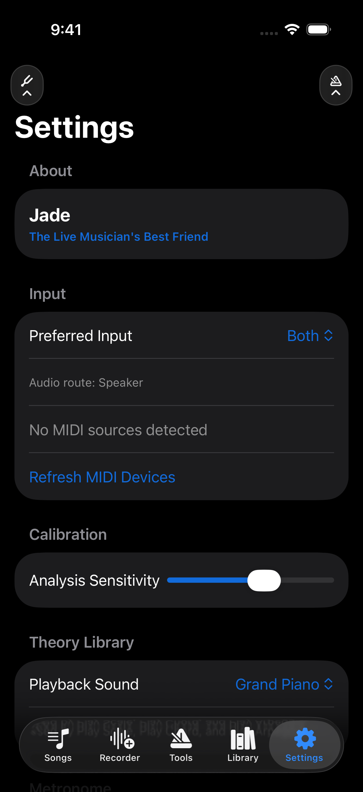
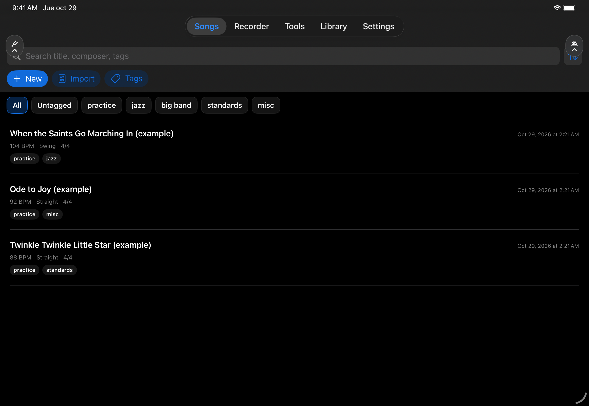
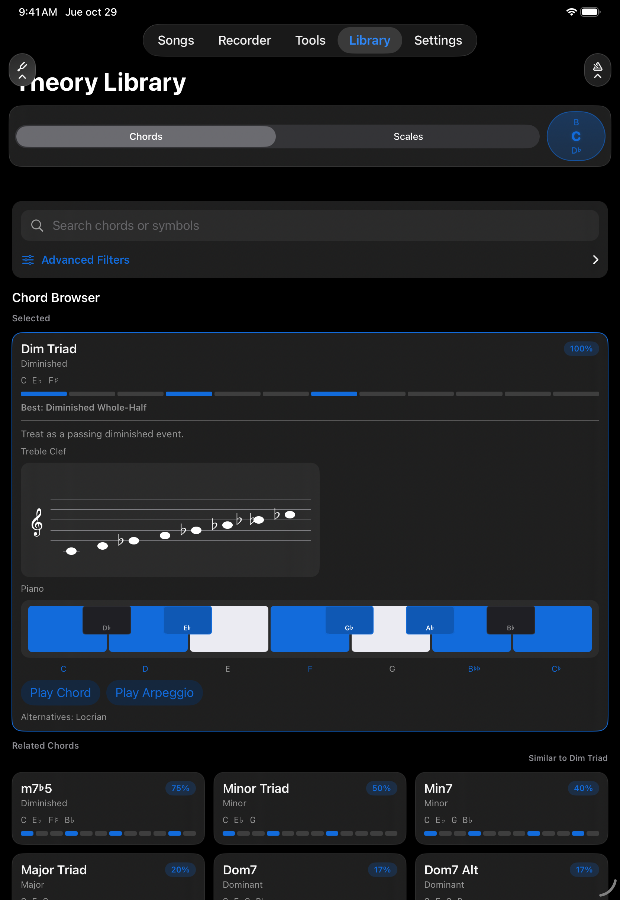
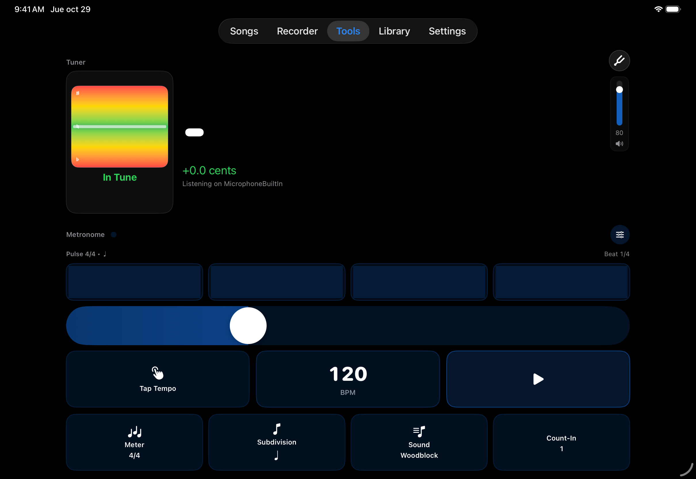
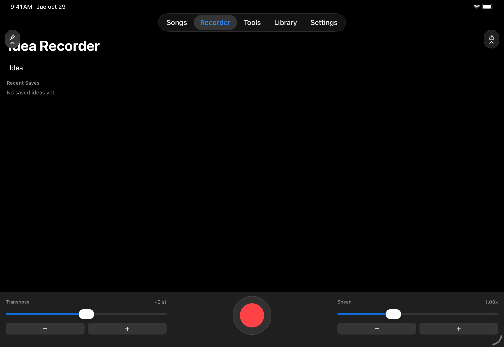

# Jade screenshots

Full-resolution captures from a Release build on iOS / iPadOS 26.2 simulators. These show the app's existing example songs and interface; image orientation was normalized without changing the interface.

## iPhone 17 Pro

| Songs | Theory Library |
| --- | --- |
|  |  |

| Tools | Settings |
| --- | --- |
|  |  |

The iPhone captures are 1206 × 2622 pixels. The tuner capture shows the microphone permission requirement; these screenshots do not establish live audio or MIDI performance.

## iPad Pro 11-inch (M5)

### Songs

### Theory Library

### Tools

### Idea Recorder

Landscape iPad captures are 2420 × 1668 pixels; the portrait theory capture is 1668 × 2420 pixels. Recording, tuning, document import, and MIDI input should be checked separately on physical hardware.

The app source used for capture is unchanged from commit `d213916e7eea8b724cdfdb05115076e0cf352c99`; subsequent repository changes before this gallery affected documentation and CI only.
